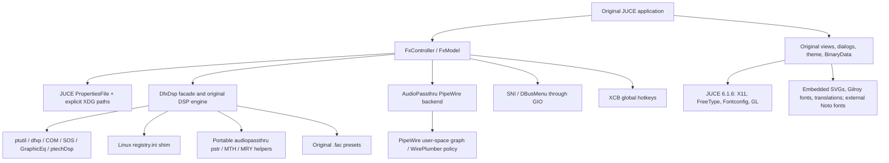

# Kubuntu port: local evidence and remaining acceptance work

This report concerns the local `kubuntu-port` worktree. Historical reports from
the imported pull request are not evidence that this build has passed a gate.
The full specification remains `prompt.md` in the parent workspace.

## Provenance

The source starts from `ealtun21/fxsound-app:feature/linux-port` at
`c5b39b887169b73c907283582ea53f4aa329aeac`. Hardening PR #3 was reviewed and
fast-forwarded at `4fff160c61c2d289db3b18c65db45a72d6e5dca1`, preserving all
contributors' history. The original Windows application was inspected at
`d8e7a23d37ed5939c2a3090a1c1756c7f2500b17` and driver at
`c78fc6d031d16bd0a5dbbdff4871cfb8715d343d`. JUCE remains 6.1.6 at its original
gitlink `2f980209cc4091a4490bb1bafc5d530f16834e58`; Resources remains pinned to
`ccec13ae1437a3c622f893cfdb5b93c8d45da549`.

## Component dependency map



The software DSP cores remain the original Aural, Lex, Wide, Maximizer, Play,
PEQ, GraphicEq and associated filter code. No replacement effect engine or
redesigned interface has been introduced.

## Windows dependency inventory

| Dependency / assumption | Source area | Linux disposition and remaining risk |
|---|---|---|
| WDK virtual driver, KS/PortCls, WASAPI, MMDevice COM | `fxsound-driver/fxvad`, Windows `audiopassthru/src/sndDevices`, `AudioPassthru` | Excluded; routable PipeWire null sink and processing filter replace device transport. No Linux kernel driver. |
| COM initialization/security, NVIDIA/AMD exports, Windows crash dumps | `fxsound/Source/Main.cpp` | Guarded for Windows; Linux uses backtrace diagnostics and signal-driven quit. Crash recovery of routing still requires further validation. |
| Service enumeration, WASAPI SysInfo | `Utils/SysInfo` | Windows implementation excluded; `linux/SysInfo_linux.cpp` used. |
| Shell tray APIs and window procedures | `FxSystemTrayView`, `FxMainWindow`, controller | SNI/DBusMenu via GDBus; JUCE owns the original window. Native Plasma interaction still needs manual testing. |
| RegisterHotKey, keyboard layout APIs | controller, `linux/LinuxHotkeys` | XCB implementation; XWayland grabs do not establish global Wayland shortcut support. Portal backend remains open. |
| Registry and Run-at-login key | controller, settings, `dsp/ptutil/dfxp`, `dsp/linux/reg_linux.cpp` | XDG settings and freedesktop autostart file. Persistent registry access stays on the control thread; the audio engine uses a bounded thread-local registry image. |
| `DWORD`, `LONG`, GUID, opaque handles, Windows SDK includes | `linux/win_compat.h`, `dsp/linux/*.h`, public audio headers | Compatibility declarations; DSP uses explicit 32-bit integers. Duplicate historical audiopassthru headers remain; CMake prefers DSP copies. |
| LLP64 `long` formats versus LP64 Linux | DSP registry/VALS/Qnt/COM diagnostics | Fixed remaining 32-bit integer print/scan formats using `PRId32`, `PRIu32`, `SCNd32`; signed timestamp regression reproduced and fixed. |
| Wide printf semantics and UTF-8 paths | DSP, VALS, pstr, file shims | PR #3 fixes incorporated and locally tested. `_wfopen_s` compatibility helper is still locale-dependent and requires further hardening. |
| Windows file/time/directory helpers | `audiopassthru/src/FILE`, `ptime`, `dsp/linux` | Windows modules excluded; Linux file/open/stat and POSIX wrappers used. `CompareFileTime` represented by portable integer comparison. |
| DLL loading / shared DFX DLL | `dfxSharedUtil.cpp` | Loading block is already `#if 0`; engine is statically linked. Compatibility loader functions are inert and must not be used by an active algorithm path. |
| GUI error message boxes in DSP | `DfxDspPrivate`, Comsftwr diagnostics | Currently no-op compatibility macros; constructor error propagation needs improvement. |
| Windows multimedia WAV/MP3 utilities and OS interrogation | `ptutil/PWAV`, `operatingSystem`, `BladeMP3EncDLL.h` | Not linked into Linux processing path. |
| `updater.exe`, installer tooling, Visual Studio projects | controller, Installer, Project | Updater launch Windows-guarded; Linux uses CMake/Ninja, AppImage and CPack DEB. |
| Executable-adjacent fonts and Windows path separators | FxTheme, preset import/export | Linux fonts installed under `share/fxsound/Fonts`; lookup supports installed/AppImage/source trees. Existing OTF Traditional Chinese assets resolved correctly. |

## Locally verified

Host: Ubuntu 26.04.1, KDE Plasma 6 Wayland, GCC 15.2.0, PipeWire 1.6.2.
Build: real DSP and PipeWire enabled, CMake 4.4.4, Ninja 1.13.2.

- Real native executable built with the existing CMake source sets.
- Thirteen native unit tests pass, including effect/power separation, presets,
  Unicode names, lifetime perturbation, integer formats, exact serial-engine
  equivalence, and a seccomp guard against callback filesystem I/O.
- The DSP facade now keeps control and audio engines separate. A bounded
  triple-buffer mailbox publishes complete settings at block boundaries; the
  audio engine retains its processing histories. Meter/time data returns through
  a second mailbox. Audio processing never takes the control mutex.
- Quantizer tables retain their original calculations and use bounded engine-owned
  storage, allocated before attachment. Callback checks count malloc, calloc,
  realloc, free and mutex acquisition. Controls, band counts, format changes,
  1-frame through 8193-frame blocks, and common rates through 192 kHz pass.
  Rates below the original engine's 16 kHz minimum follow its unsupported-format
  pass-through behavior; these are safety checks, not new DSP rate support.
- Short high-rate blocks exposed an original downsampler read before the buffer
  when no complete downsampling group fit. The Linux path processes one sample
  and repeats it within the available frames. Normal-sized blocks are unchanged.
- A deterministic trace containing parameter changes, EQ modes, bypass and rate
  changes matches the original serial Linux engine bit for bit: 262144 float
  samples, SHA256 aacb4fe921093a40917088d7a2377e2967bbe161a9968e2ee5f10c9d4f0aec32.
  This also matches the trace captured before the ownership changes. This is
  Linux serial-engine equivalence, not a Windows reference measurement.
- Seven graph/application tests pass in private PipeWire, Pulse compatibility,
  WirePlumber and D-Bus sessions: default routing, SIGTERM restoration, monitor
  volume configuration, tray hot-plug, explicit UTF-8 XDG configuration, and the
  new graph lifecycle suite and native login-minimized fixture. The latter checks stable link IDs **and object
  serials** during unrelated device changes, external unlink repair, Unicode
  node IDs and names (including emoji/spaces), selected-device fallback and
  reconnection, exact configured-default restoration, originally unset defaults,
  names containing `FxSound`, and later explicit user default choices.
- Links are reconciled by endpoint pair; unchanged links survive graph events.
  Core and property acknowledgments replace shutdown sleeps. Metadata capture
  waits for initial enumeration; claiming the virtual default waits for the
  actual property echo, since a core sync can finish before WirePlumber replies.
  Public graph reads/selection use the thread-loop lock. Device callbacks now run
  on the JUCE message-thread timer, which remains active at 500 ms in bypass. A packaged recovery test caught the original controller
  leaving its outage mute active after a bypassed output returned. Linux now
  clears that transport mute for every valid recovered output, independently of
  DSP power; repeated output-monitor captures verify transparent bypass gain.
- The self-isolated `pw-restart` test passes two complete private audio-server
  restarts (enabled and bypass), a WirePlumber-only restart and external virtual
  sink deletion. It verifies the same application remains alive, transport
  identities change, four links return, and samples reach the output monitor.
  Bypass tone peak remains within 2.5% of its original PCM amplitude. This is
  synthetic null-output recovery, not a physical suspend/resume test.
- Broad test rerun with explicit XDG paths: 36 passes, including measured preset changes, bypass,
  stereo order, selected-device fallback, restart persistence and ten clean
  start/stop cycles. The current native and refreshed AppImage handoff builds each pass all 36
  checks with clean runner exits. AppImage runs use
  `APPIMAGE_EXTRACT_AND_RUN=1`.
- During the current native 60-second synthetic playback run: 4.9% of one core,
  45 MiB resident memory, zero processor errors in the sampled `pw-top` output.
  This is a private null-device measurement, not physical-device latency or an
  hours-long stability result. The refreshed AppImage measured 4.3% of one core,
  47 MiB RSS and zero sampled processor errors in the same suite.
- All twelve AddressSanitizer unit tests pass (including the new login-entry round trip). The expanded ThreadSanitizer
  concurrency stress and serial-equivalence tests both pass. The original
  EQ/processTimer race was reproduced before the ownership fix and is resolved
  in these tests. The separate real PipeWire graph lifecycle suite now also
  passes under ThreadSanitizer with halt-on-error and no suppressions.
- Native DEB and AppImage builders produce artifacts, original desktop launcher,
  icons, presets, fonts and license notices. The final AppImage passed its playback suite, and the extracted DEB
  passed the UTF-8 XDG configuration runtime test. Installation, runtime and
  removal also pass in a disposable Ubuntu 26.04 container (details below).
- Captures confirm the original JUCE interface and translated Traditional Chinese
  text render under Xvfb at 96 DPI. They do not establish Windows pixel parity.

## Login, desktop clients and clean-container evidence

Linux startup now tolerates audio services arriving after desktop login. A
regression reproduced the original fatal initialization path: starting with no
PipeWire socket, then a core without WirePlumber metadata, never recovered. The
controller now retains its UI, saved power state and original DSP while the
backend retries at two-second intervals. Partially initialized transports are
cleaned up before retrying; the backend remains represented in the device model.
Private tests verify delayed core/session-manager startup with both saved power
states, real output-monitor samples, no visible login error/window, subsequent
server and WirePlumber restarts, and default restoration on shutdown.

The original General settings launch checkbox was visible only for Windows 7;
Linux now shows that same control. Login entries target the persistent AppImage
filename, use Desktop Entry escaping, and pass `--autostart` to keep the original
window minimized even on first launch, without the manual-launch minimize tip.
A duplicate login launch stays hidden; a manual second launch opens the existing
window using the tray D-Bus action, because JUCE 6 Linux has no application
broadcast implementation. The original JUCE process lock still prevents duplicates.
The setting reflects `Hidden`/disabled
entries, missing executables and write failures. AppImage variables inherited by
a native executable do not redirect its login entry to the parent application.

Real GIO parser/launcher tests verify exact filenames and arguments with spaces,
Unicode/emoji, percent signs, equals signs, quotes, backslashes, dollar/backticks
and newline/tab characters. An actual AppImage GUI test clicks the original
checkbox, disables/re-enables it, then relaunches through the generated desktop
entry. The AppImage filename in that test contains spaces, `%`, `=`, quotes and
Chinese characters. A screenshot of General settings confirms the control fits
its original pane without clipping. No replacement UI was introduced.

`install.sh` and `uninstall.sh` accept optional `--yes`. Native uninstall removes
only the current user's matching package login entry, preserving AppImage/custom
entries and presets. Python 3 is required for that cleanup helper. Root removal
can clean the invoking sudo user's entry; other users' files are never swept.
Their remaining entries have `TryExec` and are ignored if the executable is gone.

Actual audio clients tested in private servers:

| Client | Build | Evidence |
|---|---|---|
| Firefox | Mozilla native 158.0.1 | Browser media stream follows default FxSound; DSP changes captured output; stereo bypass levels within 0.2 dB |
| Chromium | Official snapshot 158.0.8116.0, revision 1723686 | Same output-monitor checks |
| Google Chrome | 155.0.8059.84 | Same output-monitor checks |
| ffplay | 8.0.1 | Same checks; an already-playing stream also migrates into FxSound and returns to the original output/gain on shutdown |

The input is a looping local stereo WAV played by each client's actual audio
stack. No per-client target is set to FxSound. Captures use the final null-output
monitor, and the real tray power action toggles bypass. These tests establish
routing and processing, not Windows waveform parity or physical latency.
The installed Firefox Snap refuses to launch from this VS Code cgroup; its
confinement remains unverified. Mozilla's user-local tarball was checked against
the official release SHA256SUMS. The earlier cached Playwright reference identifies
itself as Chrome for Testing; the final Chromium result uses the separate official
unbranded Chromium snapshot. Test browsers/profiles are separate from host profiles.

A fresh Ubuntu 26.04 container (base digest
`sha256:c098726dd9b9733f3e885f8de0ef375206a311b0a317eadc40d347b1115fb944`)
installs the DEB using apt dependency resolution. It passes configuration and
first-run/login-window and delayed audio-service startup tests plus all 36 audio/lifecycle checks, then removes the
package through the uninstall script. Executable, launcher, resources and native
login entry are removed; the user preset remains. Its 60-second run measured
4.1% of one core, 43 MiB RSS and zero sampled processor errors. This is a clean
headless Ubuntu container, not a full Kubuntu VM or physical audio test.

## Important test isolation finding

JUCE 6.1.6's PropertiesFile default used `~/FxSound`, and its Linux
`userApplicationDataDirectory` did not consult the XDG environment. Initial GUI
tests therefore reused files under `~/FxSound` and `~/.config/FxSound`, although
their PipeWire server was private. Explicit application config paths now fix
this; `app_xdg_config` confirms a non-ASCII XDG directory is used and the legacy
settings file is unchanged. Initial test-created legacy files have been left in
place to avoid deleting any user data.

## Remaining release gates

Update 2026-10-23: see `IMPLEMENTATION_2026-10-23.md`. Native Wayland
shortcut implementation, UTF-8 `_wfopen_s`, and live metadata clear-all
handling are now implemented and regression-tested. Manual compositor
permission/rebinding validation is still required.

1. DSP ownership, graph lifecycle TSan and private recovery tests now pass;
   extend lifecycle coverage to permission failures, hung metadata owners, abrupt
   process death and crash recovery of persistent default metadata.
2. Verify physical-device bypass and transition behavior; exact float-copy bypass and package runtime checks now pass. A regression
   test reproduced clipping of 1.4-amplitude float input while power was off.
   The Linux adapter now copies bypassed audio exactly, using a lock-free atomic
   power-state read; enabled processing retains the original DSP and clip policy.
3. Incremental links, acknowledged restoration, server/session-manager restart
   and virtual-sink recreation now pass private tests. Still verify physical
   unplug/replug, sleep/resume, long-running recovery and metadata clear-all.
   Default LeakSanitizer teardown needs the system-library investigation below.
4. UTF-8 devices, AppImage login paths/escaping, the original GUI login toggle
   and per-user native uninstall cleanup now pass tests. Verify the implemented native Wayland
   global shortcuts with the real compositor permission/rebinding UI.
5. Run main-window control interactions, both themes, scaling, menus/dialogs and
   Windows screenshot comparisons. The capture fixtures now initialize the version so the first-run welcome
   behavior does not override a requested Lite view.
6. Firefox, Chromium, Chrome and ffplay pass private default-routing/DSP/bypass
   checks. Still test Snap/desktop confinement, real speakers/headphones,
   44.1/48/96/192 kHz graph/device rates, sleep/resume, extended playback,
   physical latency, XRuns and interactive UI response.
7. Produce identical sine sweeps, impulses, pink noise and reference recordings
   through a Windows reference; measure gain, response, distortion and dynamics.
   User confirmed no Windows machine/reference is available and requested that
   visual and DSP Windows parity be documented as unverified for now.
8. DEB install/runtime/uninstall passes a clean Ubuntu 26.04 container; validate
   the full Kubuntu desktop/physical-device environment and older build baseline.
   These locally built artifacts depend on the host glibc ABI (DEB currently
   declares libc6 >= 2.43); older Kubuntu releases need an older build baseline.
9. Packaging tools are now hash-verified using `packaging/appimage-tools.sha256`.
   Upstream continuous URLs are mutable: a changed download deliberately fails
   verification. Archive the matching tool bytes or provide immutable URLs for
   long-term retrieval of the same build inputs.

## PipeWire sanitizer boundary

The real graph suite passes ThreadSanitizer. Its AddressSanitizer run passes
with leak detection enabled and `PIPEWIRE_DLCLOSE=false`, PipeWire's documented
module-retention diagnostic setting. Default unloading reports 4108 bytes in
34 retained allocations below PipeWire module initialization on this host.
`linux/tests/repro_pipewire_teardown.cpp` reproduces the same 34-allocation
pattern (3677 bytes with the host session environment) using only `pw_init`,
a thread loop, `pw_context_new`, complete teardown and `pw_deinit`; it links no
FxSound code. Its diagnostic run with retained modules passes.

This is evidence of a system-library/module-unloading boundary, not proof that
default teardown is leak-free. No LeakSanitizer suppression or disabled leak
detection was used. Keep both failure and diagnostic logs. Upstream memory
ownership investigation remains open. The backend now pairs each `pw_init`
reference with `pw_deinit` after its last loop; this requires PipeWire >=0.3.49,
whose reference-counted reinitialization semantics are documented in upstream
[`pipewire.c`](https://github.com/PipeWire/pipewire/blob/1.6.2/src/pipewire/pipewire.c).
The same source documents `PIPEWIRE_DLCLOSE`. The thread-loop locking and stop
rules are in the [PipeWire thread-loop documentation](https://docs.pipewire.org/page_thread_loop.html). Runtime reconnects retain the backend's library reference.

## Licensing and distribution

Preserve the application's AGPL-3.0-or-later notices and provide corresponding
source for distributed builds. JUCE 6.1.6's own LICENSE.md specifies its GPLv3 /
commercial licensing options and permissive module exceptions; it is shipped
unchanged. Debian runtime libraries remain managed by apt; AppImage includes
available bundled-library copyright files.

The Windows driver's separate Microsoft sample license contains a Windows
platform limitation. No driver code is used in the Linux build. The source tree
contains Gilroy/Noto font assets, but a complete asset-specific license and
trademark permission audit has not been established. Do not represent this
development build as an endorsed official FxSound Linux release.

## Reproduce

Install the development dependencies listed in `linux/README.md`, initialize the
two pinned submodules, then:

```sh
cmake --preset linux-release
cmake --build --preset linux-release
ctest --preset linux-unit
linux/tests/run-isolated.sh ctest --test-dir build-release -L pw-live --output-on-failure
# This test creates and owns its private session; do not share servers it restarts.
ctest --test-dir build-release -L pw-restart --output-on-failure
packaging/build-deb.sh
packaging/build-appimage.sh --output "$PWD/dist"
python3 packaging/build-source.py
```

`packaging/install.sh <deb>` and `packaging/uninstall.sh` use apt for package
ownership and dependency handling. No system install or live-host audio routing
change was needed for these private-session tests.

Sanitizer builds:

```sh
cmake -S . -B build-asan -G Ninja -DFXSOUND_SANITIZER=address -DCMAKE_BUILD_TYPE=Debug
cmake --build build-asan --target dsp_selftest reg_selftest dsp_settings_selftest dsp_integer_formats_selftest process_selftest dsp_trace_realtime dsp_trace_serial --parallel 2
ctest --test-dir build-asan -L unit --output-on-failure
cmake -S . -B build-tsan -G Ninja -DFXSOUND_SANITIZER=thread -DCMAKE_BUILD_TYPE=Debug
cmake --build build-tsan --target dsp_concurrency_selftest --parallel 2
ctest --test-dir build-tsan -L dsp-race --output-on-failure
```

The thread-sanitized DSP stress test now passes without suppressions. The audio
engine owns its mutable DSP state; changes arrive as complete bounded snapshots.
There is no dry-block fallback on control contention. The original serial engine
remains an independent numerical oracle in `dsp_handoff_equivalence`.

On hosts without FUSE 2, launch the AppImage with
`APPIMAGE_EXTRACT_AND_RUN=1 ./FxSound-1.2.8.0-x86_64.AppImage`. That is the launch
mode tested here; ordinary FUSE mounting has not been validated on this host.
